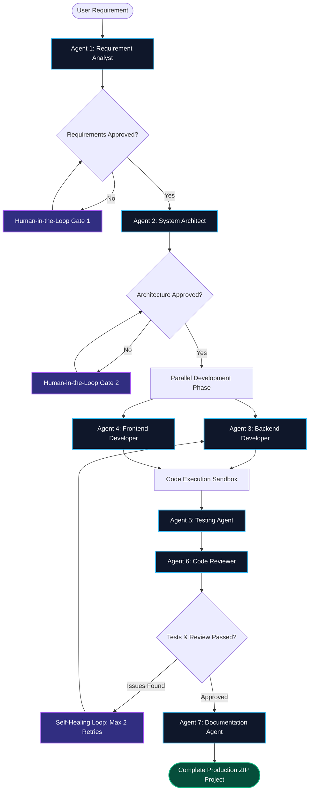

# ⚡ AgentForge — Multi-Agent AI Software Development Platform

[](https://openjdk.org/)
[](https://spring.io/projects/spring-boot)
[](https://react.dev/)
[](https://www.typescriptlang.org/)
[](https://vitejs.dev/)
[](https://tailwindcss.com/)
[](https://www.docker.com/)

> **"Your AI Engineering Team. One Platform."**  
> AgentForge is an enterprise-grade, full-stack AI-powered software development platform. Users provide natural-language software requirements, and seven specialized autonomous AI agents collaborate through a stateful directed acyclic graph (DAG) to plan, design, code, test, self-heal, review, and document production-ready full-stack applications.

---

## 📑 Table of Contents
1. [Architecture & Multi-Agent Workflow](#-architecture--multi-agent-workflow)
2. [The Seven Specialized Agents](#-the-seven-specialized-agents)
3. [Advanced Platform Capabilities](#-advanced-platform-capabilities)
   - [Human-In-The-Loop Approval Gates](#1-human-in-the-loop-approval-gates)
   - [Autonomous Self-Healing Loop](#2-autonomous-self-healing-loop)
   - [Code Execution Sandbox](#3-code-execution-sandbox)
   - [File Versioning & Revision History](#4-file-versioning--revision-history)
   - [Real-Time SSE Telemetry](#5-real-time-sse-telemetry)
4. [Technology Stack](#-technology-stack)
5. [Quick Start & Local Setup](#-quick-start--local-setup)
   - [Running with Docker Compose](#option-a-docker-compose-recommended)
   - [Running Locally (Spring Boot + React)](#option-b-running-locally-developer-mode)
6. [Frontend UI/UX Overview (9 Distinct Pages)](#-frontend-uiux-overview)
7. [API Endpoints Reference](#-api-endpoints-reference)
8. [Database Schema](#-database-schema)
9. [Verification & Testing](#-verification--testing)

---

## 🏛 Architecture & Multi-Agent Workflow

AgentForge coordinates seven autonomous agents organized in a structured DAG execution pipeline managed by a centralized `AgentOrchestrator`.



---

## 🤖 The Seven Specialized Agents

Each agent is an autonomous Spring Bean implementing structured input/output JSON schemas:

| # | Agent Name | Spring Bean | Primary Responsibilities | Structured Output |
|---|---|---|---|---|
| **1** | **Requirement Analyst** | `RequirementAnalystAgent` | Parses natural language, extracts functional & non-functional requirements, defines module boundaries, identifies dependencies. | `RequirementSpec` (JSON) |
| **2** | **System Architect** | `SystemArchitectAgent` | Synthesizes architecture, generates relational ERD schemas, designs REST endpoints, specifies folder hierarchy and design patterns. | `SystemArchitectureSpec` (JSON) |
| **3** | **Backend Developer** | `BackendDeveloperAgent` | Generates complete Java 21 / Spring Boot 3 source files (Entities, Repositories, Services, Controllers, DTOs, Security, `pom.xml`). | `List<GeneratedSourceFile>` |
| **4** | **Frontend Developer** | `FrontendDeveloperAgent` | Generates modern React + TypeScript + Tailwind components, routing, state hooks, and API client layers. | `List<GeneratedSourceFile>` |
| **5** | **Testing Agent** | `TestingAgent` | Generates JUnit 5 and React Testing Library suites, dispatches to execution sandbox, parses test traces. | `TestExecutionReport` (JSON) |
| **6** | **Code Reviewer** | `CodeReviewerAgent` | Inspects code quality, identifies OWASP security vulnerabilities, evaluates algorithmic efficiency, scores maintainability. | `CodeReviewReport` (JSON) |
| **7** | **Documentation Agent** | `DocumentationAgent` | Generates root `README.md`, OpenAPI/Swagger specs, deployment guides, and architecture diagrams. | `DocumentationBundle` (JSON) |

---

## 🚀 Advanced Platform Capabilities

### 1. Human-in-the-Loop Approval Gates
Execution transitions through strict human checkpoints to prevent runaway hallucination:
- **Requirement Approval Gate**: Halts execution when requirements are analyzed, allowing users to review functional/non-functional scope before system design.
- **Architecture Approval Gate**: Halts execution after database schema and REST API endpoints are designed, ensuring architectural alignment before source code generation.

### 2. Autonomous Self-Healing Loop
When the Testing Agent detects compiler errors, test failures, or runtime crashes:
1. Error diagnostics, compiler logs, and stack traces are captured by the `SandboxManager`.
2. The orchestrator routes the diagnostic payload to the responsible Developer Agent.
3. The Developer Agent diagnoses the root cause and generates a corrected file revision.
4. The file revision is version-bumped and saved.
5. The sandbox re-executes tests up to a configurable maximum retry limit (default: 2 retries).

### 3. Code Execution Sandbox
Two execution sandbox engines prevent rogue code execution:
- **ProcessIsolatedSandbox**: Runs inside a sub-process wrapper with a strict 30-second watchdog timer, bounded memory, and stdout/stderr capture.
- **DockerExecutionSandbox**: Spins up an ephemeral container with `--network none`, `--memory 512m`, `--cpus 1.0`, and read-only mounts.

### 4. File Versioning & Revision History
Every generated file in `generated_files` tracks:
- `version` counter (1, 2, 3...)
- Complete file content history
- UI diff viewer comparing revisions
- One-click rollback/restore capability via `/api/projects/{id}/files/{fileId}/restore/{version}`
- Per-file regeneration trigger via `/api/projects/{id}/files/{fileId}/regenerate`

### 5. Real-Time SSE Telemetry
The frontend subscribes to `GET /api/sse/projects/{id}`:
- Live streaming of agent status transitions (`IDLE` ➔ `RUNNING` ➔ `COMPLETED` ➔ `WAITING_APPROVAL`)
- Log streaming line-by-line in real-time
- Instant UI state reflection without polling

---

## 💻 Technology Stack

### Backend
- **Java**: 21 / 25 LTS
- **Framework**: Spring Boot 3.3.4 (Spring Data JPA, Spring Web, Spring Security, Validation)
- **AI Integration**: Spring AI / Direct Gemini 1.5 Pro & Flash API / OpenAI GPT-4o & GPT-4o-mini API / Dynamic Context-Aware Mock Simulation
- **Database**: PostgreSQL 16 with `pgvector` extension (production) / Embedded H2 Database (zero-dependency development)
- **Security**: Stateless JWT with BCrypt password hashing and custom filter chain
- **Build Tool**: Apache Maven 3.9.x

### Frontend
- **Framework**: React 18 with TypeScript 5
- **Build Tool**: Vite 5
- **Styling**: Tailwind CSS (custom dark theme with deep navy palette `#070b14`, `#0b1120`, `#0f172a`, `#131e36`)
- **Icons**: Custom SVG Lucide React icon suite
- **Charts & Visuals**: Recharts responsive metrics, ERD relationship views

---

## ⚡ Quick Start & Local Setup

### Option A: Docker Compose (Recommended)
Run the entire production stack (PostgreSQL + pgvector, Backend, Frontend) with a single command:

```bash
# 1. Clone repository
git clone https://github.com/agentforge/agentforge.git
cd AgentForge

# 2. Configure environment (optional, defaults to rich MOCK AI mode)
cp .env.example .env

# 3. Spin up all services
docker-compose up --build
```
- Open `http://localhost:8080` or `http://localhost:3000`
- Pre-seeded Demo Account: `demo@agentforge.ai` / `password123`

---

### Option B: Running Locally (Developer Mode)

#### 1. Backend (Embedded H2 Mode - Zero External Setup Required)
```bash
cd backend
# Build and run with the embedded Maven wrapper
.\mvn.bat spring-boot:run
```
The backend starts on `http://localhost:8080` with pre-seeded demo user and sample project.  
H2 Web Console is available at `http://localhost:8080/h2-console` (JDBC URL: `jdbc:h2:mem:agentforge_db`, user: `sa`, no password).

#### 2. Frontend (Live Vite Dev Server)
```bash
cd frontend
npm install
npm run dev
```
The frontend starts on `http://localhost:5173` with automatic API proxying to `http://localhost:8080`.

---

## 🖥 Frontend UI/UX Overview

AgentForge features **9 dedicated dark-mode views**:

1. **Landing Page**: Hero presentation, value proposition, 7-agent pipeline preview, CTA buttons.
2. **Dashboard**: High-level platform metrics (total projects, active runs, success rate, test coverage), recent project cards, live agent activity ledger.
3. **Create Project**: Interactive creation form with natural language requirements input, framework selection (Spring Boot / React), database selection (PostgreSQL / MySQL / MongoDB), and AI model selector.
4. **Agent Workspace**: Real-time status of all 7 agents, progress bars, active task descriptions, execution durations, and live terminal logs.
5. **Architecture View**: Interactive ERD visualizer, entity attribute tables, REST API endpoint directory, and module dependency graphs.
6. **Code Generation View**: Hierarchical file tree browser, syntax-highlighted code editor, file version history with diff comparison, file regeneration, and full ZIP download.
7. **Testing Dashboard**: Real-time test statistics (Passed / Failed / Execution Time), failed test stack trace inspector, and isolated re-test trigger.
8. **Code Review Dashboard**: Automated code quality score (0-100), OWASP security vulnerability scanner, code smell detector, and reviewer suggestions.
9. **Project Documentation**: Interactive preview of generated `README.md`, architecture documentation, API guides, and installation manuals.

---

## 📡 API Endpoints Reference

### Authentication
- `POST /api/auth/register` — Register a new account
- `POST /api/auth/login` — Login and obtain JWT token
- `GET /api/auth/me` — Get current user profile

### Projects & Dashboard
- `GET /api/dashboard/stats` — Overall dashboard metrics
- `GET /api/projects` — List user projects
- `GET /api/projects/{id}` — Get single project details
- `POST /api/projects` — Create and initialize project

### Multi-Agent Orchestration
- `POST /api/projects/{id}/start` — Start / resume multi-agent pipeline
- `POST /api/projects/{id}/pause` — Pause running pipeline
- `POST /api/projects/{id}/approve` — Approve current human-in-the-loop gate
- `GET /api/projects/{id}/executions` — Get execution history of all 7 agents
- `GET /api/sse/projects/{id}` — Real-time Server-Sent Events stream

### Code Artifacts & Versioning
- `GET /api/projects/{id}/files` — Get all generated files
- `GET /api/projects/{id}/files/{fileId}/history` — Get file revision history
- `POST /api/projects/{id}/files/{fileId}/regenerate` — Request AI agent to rewrite file
- `POST /api/projects/{id}/files/{fileId}/restore/{version}` — Rollback file to specific revision
- `GET /api/projects/{id}/download` — Export full compilable project as standard ZIP

### Testing & Code Review
- `GET /api/projects/{id}/tests` — Get latest test execution results
- `POST /api/projects/{id}/tests/run` — Trigger isolated test run
- `GET /api/projects/{id}/reviews` — Get code review reports and security findings

### AI Settings
- `GET /api/ai-config` — Current AI provider, model, and active features
- `POST /api/ai-config` — Switch between Gemini, OpenAI, and Mock providers

---

## 🗄 Database Schema

Designed for PostgreSQL 16 + `pgvector` with JPA entity mappings:

- `users` — User credentials, role, timestamp
- `projects` — Project metadata, target tech stack, natural language requirements, status
- `agents` — Catalog of the 7 AI agents with system prompts and descriptions
- `agent_executions` — Individual agent execution logs, status, structured input/output JSON
- `generated_files` — Code repository with file paths, source code, language, and revision numbers
- `test_results` — Unit and integration test case outcomes, execution durations, error logs
- `code_reviews` — Static analysis findings, severity ratings (`CRITICAL`, `WARNING`, `INFO`), suggested fixes
- `project_documents` — Markdown specifications, installation guides, OpenAPI docs

---

## 🧪 Verification & Testing

Unit tests for backend security, JWT parsing, and AI agent execution are included:

```bash
cd backend
.\mvn.bat test
```
**Test Results:**
- `AiAgentExecutionTest`: Verifies RequirementAnalystAgent, SystemArchitectAgent, BackendDeveloperAgent structured JSON generation.
- `AuthServicePureTest`: Verifies user registration, duplicate email rejection, and BCrypt credential validation.
- `SecurityTest`: Verifies JWT issuance, claims parsing, signature verification, and expiration.
- **Status: 7 Tests Run, 7 Passed, 0 Failures.**

---

## 📄 License
AgentForge is released under the **MIT License**.
